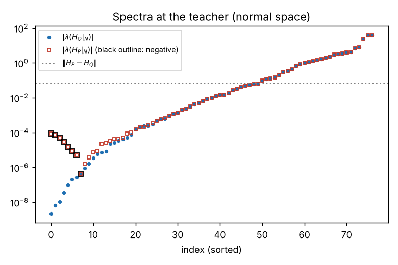
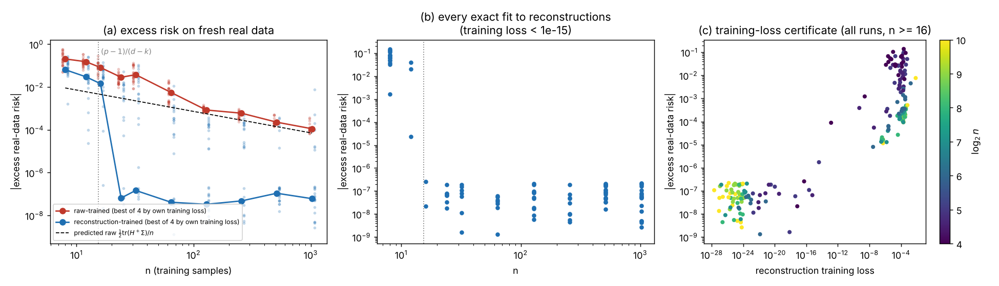
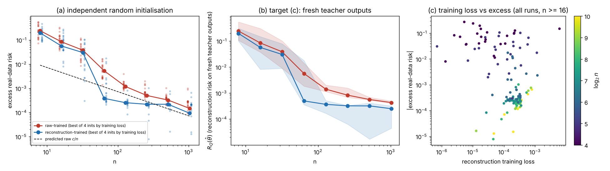
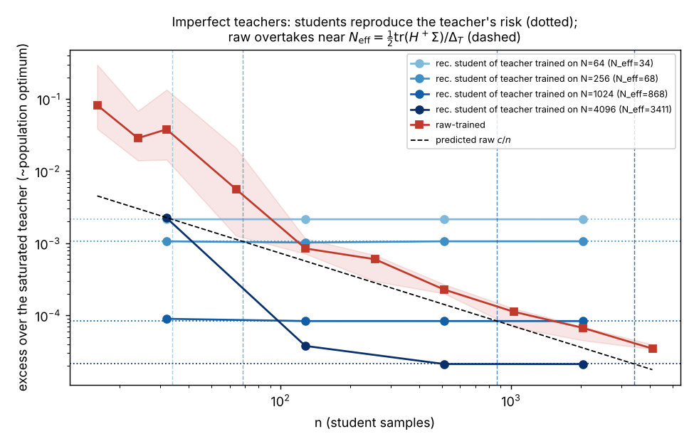

# 0. Results at a glance

**Setting.** A neural decoder $D_\theta:K\to\mathbb R^d$ with canon $M_\theta=D_\theta(K)$, an exact projection oracle $\pi_\theta$, reconstruction risk $R_P(\theta)=\tfrac12\mathbb E_P\lVert X-\pi_\theta(X)\rVert^2$. A teacher $\theta_*$ has been trained on $P$ and frozen; $Q=(\pi_{\theta_*})_\#P$. One student learns from raw samples $X_i\sim P$, the other from reconstructions $Y_i=\pi_{\theta_*}(X_i)$. Same architecture, latent domain, capacity class. Following the suggestion to leave the online setting, the main results are for **batch training to convergence** on $n$ samples (empirical-risk minimisation); the online version is in §9.

The mechanism is the batch counterpart of the vanishing-gradient-noise observation. Every reconstruction lies exactly on a canon that the architecture can represent, so all $n$ per-sample losses have a **common exact zero** at the teacher. The empirical minimiser therefore does not move with the sample. Raw per-sample losses have no common zero ($\Sigma\neq0$), so the raw empirical minimiser fluctuates by $\Theta(n^{-1/2})$ and overfits.

**Proved.**

| # | Statement | Type |
|----|--------------------------------------------------------------|-----------|
| Thm 1 | **Exact transmission.** If the teacher's canon is *regular* (embedded, interior latent support), *Q-rigid* (its only first-order deformations that keep it through the reconstructions are parameter symmetries), and the zero set of $R_Q$ is the symmetry orbit, then there are $C,c>0$ such that, for every $n$, with probability $\ge 1-Ce^{-cn}$, **every** student that fits the $n$ reconstructions exactly has exactly the teacher's canon — the *whole* canon, including parts of the repertoire that the data never exercise. Consequences: all four targets at once — zero excess real-data risk, exact imitation $\pi_{\hat\theta}=\pi_{\theta_*}$ on fresh real inputs, $R_Q=0$, and canon recovery — plus zero generalisation gap. No optimality of the teacher is used, and $n_0$ does not depend on the noise level of $P$. | statistical (ERM), certifiable |
| Lem 6.2 | If the teacher is the **unique global minimiser modulo symmetries**, the orbit condition holds automatically, and the global identifiability margin of the reconstruction problem is controlled by that of the raw problem. | structural |
| Prop 6.1 | **Rigidity from sharpness:** $\lambda_{\min}(H_Q|_N)\ \ge\ \lambda_{\min}(H_P|_N)-C_2\sqrt{2R_*}$. A strict teacher whose sharpness dominates its residual–curvature coupling is Q-rigid. | local geometry |
| Thm 2 | **No raw learner beats $1/n$.** If the teacher is a nondegenerate unique global minimiser and $R_*>0$ (with an output bias), then *every* procedure using $n$ raw samples has worst-case expected excess risk $\ge a/(64n)$ over two nearby worlds. The raw ERM overfits by $\approx\operatorname{tr}(H^+\Sigma)/n$. | minimax lower bound |
| Thm 3 | **Dichotomy.** Combining the two: $n_{\mathrm{rec}}(\varepsilon)=O(\log(1/\varepsilon))$, and exact transmission at a finite $n_0$, versus $n_{\mathrm{raw}}(\varepsilon)\ge a/(64\varepsilon)$. | statistical separation |
| Thm 4 | **Imperfect teachers.** The reconstruction student reproduces the teacher's canon, and hence exactly the teacher's real-data risk, for every $n\ge n_0$. It never improves on the teacher. The advantage window is $n_0\le n\lesssim N_{\mathrm{eff}}=\operatorname{tr}(H^+\Sigma)/(2\Delta_{\mathrm{teacher}})$; for a teacher trained on $N$ raw samples, $N_{\mathrm{eff}}\approx N$. **$n_0$ reconstructions transmit what $N$ raw samples taught the teacher.** | statistical |
| Thm 5 | Online: constant-step SGD on reconstructions converges linearly inside the rigidity basin; Thm 2 bounds raw SGD with any schedule. | algorithmic (local) vs statistical |

**Obstructions** (each made precise below):

* **O1 — memorisation threshold (Prop 7).** At sample sizes where a raw student can exactly interpolate its sample near the teacher, the set of exact fits to reconstructions is itself a manifold of dimension $p+nk-nd$ larger than the orbit. So the strongest reading of "raw training fully overfits while reconstruction training fully doesn't" fails for *all* minimisers there, and needs an implicit-bias hypothesis. Exactness needs $n(d-k)\ge p-\dim(\text{orbit})$. What survives in that regime is a uniform benignness bound for exact fits to reconstructions (Prop 2.3).
* **O2 — imperfect teachers are never surpassed (Thm 4).** This explains the digits-pilot trade-off.
* **O3 — basin access is not implied (Prop 8).** If $P$ has a symmetry that the capacity-limited canon must break, every inequivalent optimal canon is (for small residuals) a spurious local minimum of the reconstruction objective with *constant* excess risk, where raw training is fine. The training-loss certificate (Cor 3.2) detects this failure; raw training has no such certificate.
* **O4 — conditioning and basin access (numerics).** In a tanh decoder Q-rigidity holds, but it is badly conditioned ($\lambda_{\min}/\lambda_{\max}\approx5\times10^{-11}$ on the normal space). From independent random initialisations, gradient training on reconstructions did not reach an exact fit within our budget. It stalled in spurious basins, which its training loss flagged. Without a capacity bound, a wider decoder approaches zero loss only along valleys in which the weights grow.

**Numerics** (§10; a tanh decoder on a circle latent in $\mathbb R^6$, $p=78$, samples-saturated teacher).

* **Every exact fit, from the predicted threshold on.** Every exact fit to $n\ge16$ reconstructions has real-data excess at the evaluation's resolution ($\le3\times10^{-7}$). Exact fits to $n\le12$ do not, matching the dimension count $(p-1)/(d-k)=15.4$ of Prop 7.
* **Raw students** follow the predicted $\tfrac12\operatorname{tr}(H^+\Sigma)/n$ within a factor $\approx2$, and overfit with a test–train gap of about twice their excess.
* **In-basin students.** With students started in the teacher's basin and selected by their own training loss, the separation is 3–6 orders of magnitude for $24\le n\le1024$.
* **Independent random inits.** Reconstruction students still win at every $n\le1024$ (by $14\times$ down to $1.6\times$), but they plateau at their optimisation floor, so the advantage there is a finite window.
* **Imperfect teachers** are reproduced exactly, with the predicted window.
* **Symmetry-breaking traps** appear exactly as predicted.

---

# 1. Setting

**1.1 Objects.** $K$ is a compact connected $C^3$ manifold (the latent domain). The capacity class $\Theta\subset\mathbb R^p$ is compact, and $D:\Theta'\times K\to\mathbb R^d$ is $C^3$ on an open $\Theta'\supset\Theta$. Put $M_\theta=D_\theta(K)$ (compact), $\ell_\theta(x)=\tfrac12\operatorname{dist}(x,M_\theta)^2$, and $R_\mu(\theta)=\mathbb E_\mu\,\ell_\theta$ for any law $\mu$. $P$ has compact support. The teacher is $\theta_*\in\operatorname{int}\Theta$, $M_*:=M_{\theta_*}$, $\pi_*$ is a measurable nearest-point selection onto $M_*$, $Q=(\pi_*)_\#P$, and $R_*:=R_P(\theta_*)$. Teacher optimality is assumed only where stated.

**1.2 Symmetries.** $G$ is a compact group acting on $\mathbb R^p$ by orthogonal maps that preserve $\Theta$, with diffeomorphisms $\rho_g$ of $K$ such that $D_{g\theta}=D_\theta\circ\rho_g$. Examples: hidden-unit permutations; sign flips for odd activations; latent isometries realised by the first layer. Then $M_{g\theta}=M_\theta$ and $\ell_{g\theta}=\ell_\theta$. The *orbit* is $G\theta_*$.

**1.3 The zero set.** $Z:=\{\theta\in\Theta:\ R_Q(\theta)=0\}=\{\theta\in\Theta:\ \operatorname{supp}Q\subseteq M_\theta\}$ (closed). Always $G\theta_*\subseteq Z$.

**1.4 Learners (batch).** Draw i.i.d. $X_1,\dots,X_n\sim P$ and put $Y_i=\pi_*(X_i)$. The raw student minimises $\hat R^P_n(\theta)=\frac1n\sum\ell_\theta(X_i)$ and the reconstruction student minimises $\hat R^Q_n(\theta)=\frac1n\sum\ell_\theta(Y_i)$, both over $\Theta$. "Training fully" is idealised as reaching a global minimiser. Cor 3.2 turns this into a verifiable condition, and §9 discusses algorithms.

**1.5 Local objects at a canon point.** At $(\theta,z)$ write $J=\partial_\theta D_\theta(z)\in\mathbb R^{d\times p}$ and $A=\partial_zD_\theta(z)\in\mathbb R^{d\times k}$. $P^\perp$ is the orthogonal projector onto $(\operatorname{range}A)^\perp$, the normal space of the canon. For $y=D_{\theta_0}(z_y)\in M_{\theta_0}$ define the **normal Gauss–Newton matrix**
$$G(y;\theta_0)=J^\top P^\perp J\ \succeq0,\qquad H_Q(\theta_0)=\mathbb E_Q\,G(Y;\theta_0).$$
Also define $H_P=\nabla^2R_P(\theta_*)$ (when it exists) and $\Sigma=\mathbb E_P[\nabla\ell_{\theta_*}(X)\nabla\ell_{\theta_*}(X)^\top]$. $N_{\theta_0}$ is the orthogonal complement of $T_{\theta_0}(G\theta_0)$. By $G$-invariance, $\nabla\ell_{\theta_*}(x)\in N_{\theta_*}$ for every $x$, so $\Sigma$ lives on $N:=N_{\theta_*}$.

---

# 2. Universal facts (no regularity, any teacher)

**Proposition 2.1 (two-sided transfer).** For every $\theta$ and $x$,
$$\operatorname{dist}(x,M_\theta)\le\lVert x-\pi_*(x)\rVert+\operatorname{dist}(\pi_*(x),M_\theta),$$
and therefore
$$\sqrt{R_P(\theta)}\le\sqrt{R_*}+\sqrt{R_Q(\theta)},\qquad \sqrt{R_Q(\theta)}\le\sqrt{R_*}+\sqrt{R_P(\theta)}.$$

*Proof.* The first line is the triangle inequality through the point of $M_\theta$ nearest to $\pi_*(x)$. Minkowski's inequality in $L^2(P)$ gives the second. For the third, use $\operatorname{dist}(\pi_*(x),M_\theta)\le\lVert\pi_*(x)-x\rVert+\operatorname{dist}(x,M_\theta)$. $\square$

The left inequality is the stated transfer inequality ($R_P-R_*\le R_Q+2\sqrt{R_*R_Q}$). The right one shows that the two square-root risk landscapes are uniformly within $\sqrt{R_*}$ of each other; it is used in Lemma 6.2 and Prop 8.

**Proposition 2.2 (interpolation; globally self-bounding gradients).** Let $y\in\mathbb R^d$, $z^\star\in\arg\min_z\lVert y-D_\theta(z)\rVert$, and let $g=-J_\theta(z^\star)^\top(y-D_\theta(z^\star))$ be the envelope gradient used by SGD. If $\phi(\theta')=\tfrac12\lVert y-D_{\theta'}(z^\star)\rVert^2$ has $L$-Lipschitz gradient on the segment $[\theta,\theta-g/L]$, then
$$\lVert g\rVert^2\le2L\,\ell_\theta(y).$$
In particular, for $y\in M_*$: $\ell_{\theta_*}(y)=0$ and $g=0$.

*Proof.* $\ell_{\theta'}(y)\le\phi(\theta')\le\phi(\theta)+\langle g,\theta'-\theta\rangle+\tfrac L2\lVert\theta'-\theta\rVert^2$. Take $\theta'=\theta-g/L$ and use $\ell\ge0$. $\square$

So reconstruction-gradient noise is multiplicative everywhere, not only near the teacher. For raw data, $\mathbb E\lVert g_{\theta_*}(X)\rVert^2=\operatorname{tr}\Sigma$, and with a trainable output bias $c$ one has $\nabla_c\ell_{\theta_*}(x)=-(x-\pi_*(x))$, so $\Sigma\neq0$ whenever $R_*>0$.

**Proposition 2.3 (exact fits to reconstructions are uniformly benign).** For *any* $\theta$, of any architecture or capacity, with $Y_1,\dots,Y_n\in M_\theta$:
$$R_Q(\theta)\le q_n:=\tfrac12\,\mathbb E_{Y\sim Q}\min_{i\le n}\lVert Y-Y_i\rVert^2,\qquad R_P(\theta)\le\big(\sqrt{R_*}+\sqrt{q_n}\big)^2.$$
We have $q_n\to0$ almost surely, and $q_n=O_P\big((\log n/n)^{2/k}\big)$ if $Q$ has a density bounded below on a $k$-dimensional canon.

*Proof.* $\operatorname{dist}(Y,M_\theta)\le\min_i\lVert Y-Y_i\rVert$, then Prop 2.1. $\square$

There is no analogue for exact fits to raw data. The corresponding quantity $\tfrac12\mathbb E\min_i\lVert X-X_i\rVert^2$ scales with the intrinsic dimension of $P$ (typically $d$), not that of the canon.

**Proposition 2.4 (analytic decoders: no hallucination; exact imitation on $Z$).** Assume $K$ is a compact connected real-analytic manifold without boundary, each $D_\theta$ is real-analytic on $K$, $D_*$ is an analytic embedding, and $\mathcal H^k(\operatorname{supp}Q)>0$ (e.g. $Q$ has a density on $M_*$). Then every $\theta\in Z$ satisfies
$$\operatorname{supp}Q\subseteq M_\theta\subseteq M_*.$$
Consequently, for every $\theta\in Z$: $\operatorname{dist}(X,M_\theta)=\operatorname{dist}(X,M_*)$ $P$-a.s., $R_P(\theta)=R_*$, and if nearest points on $M_*$ are $P$-a.s. unique, $\pi_\theta(X)=\pi_*(X)$ $P$-a.s.

*Proof.* Let $V$ be a tubular neighbourhood of $M_*$ on which the normal-coordinate map $\nu(x)=x-\pi_*(x)$ is analytic, so $M_*=V\cap\{\nu=0\}$. The set $E=D_\theta^{-1}(M_*)$ is closed in $K$ and analytic in the open set $D_\theta^{-1}(V)$. If $\dim E<k$, then $E$ is a countable union of analytic submanifolds of dimension $<k$, so $\mathcal H^k(D_\theta(E))=0$. That contradicts $D_\theta(E)=M_\theta\cap M_*\supseteq\operatorname{supp}Q$. Hence $E$ contains an open set $W$. On the connected component $C\ni W$ of $D_\theta^{-1}(V)$, the analytic map $\nu\circ D_\theta$ vanishes on $W$, hence on $C$. Next, $C$ is closed in $K$: a limit point $w$ has $D_\theta(w)\in M_*\subset V$, so a connected neighbourhood of $w$ inside $D_\theta^{-1}(V)$ meets $C$ and is therefore contained in $C$. So $C=K$, i.e. $D_\theta(K)\subseteq M_*$. For the consequences, $\pi_*(X)\in\operatorname{supp}Q\subseteq M_\theta$ a.s. gives $\operatorname{dist}(X,M_\theta)\le\operatorname{dist}(X,M_*)$, and $M_\theta\subseteq M_*$ gives the reverse. A nearest point of $M_\theta$ is then a nearest point of $M_*$. $\square$

So, for analytic decoders, reaching $R_Q=0$ already *is* exact functional transmission of the teacher's reconstruction map (the user's target (b)). This holds for any teacher, optimal or not. The student's canon can be no larger than the teacher's.

---

# 3. Exact transmission from finitely many reconstructions

**Assumptions.**

* **(A1) Capacity.** $\Theta$ is compact, $D\in C^3$ near $\Theta\times K$, and $\theta_*\in\operatorname{int}\Theta$.
* **(A2) Regular canon.** $D_*$ is an embedding (injective immersion), and the latent support $S_*:=D_*^{-1}(\operatorname{supp}Q)\subset\operatorname{int}K$ (automatic if $\partial K=\emptyset$).
* **(A3) Orbit zero set.** $Z=G\theta_*$: within the capacity class, the canon on $\operatorname{supp}Q$ determines the parameters up to symmetry. *By Lemma 6.2 this is automatic when the teacher is the unique global minimiser of $R_P$ modulo $G$.*
* **(A4) Q-rigidity.** $\mu:=\lambda_{\min}\big(H_Q(\theta_*)|_N\big)>0$. Equivalently $\ker H_Q(\theta_*)=T_{\theta_*}(G\theta_*)$: the only infinitesimal parameter deformations that move the canon tangentially along $\operatorname{supp}Q$ are symmetry directions. Prop 6.1 derives this from teacher sharpness.

**Theorem 1 (exact transmission).** Under (A1)–(A4) there are constants $C,c>0$, depending on the architecture, $\Theta$, $M_*$ and $Q$ but not on $n$, such that for every $n$, with probability at least $1-Ce^{-cn}$,
$$\arg\min_{\Theta}\hat R^Q_n=\{\theta\in\Theta:\hat R^Q_n(\theta)=0\}=G\theta_* .$$
On this event every reconstruction-trained student $\hat\theta$ satisfies $M_{\hat\theta}=M_*$. Hence $R_Q(\hat\theta)=\hat R_n^Q(\hat\theta)=0$ (no generalisation gap), $R_P(\hat\theta)=R_*$, and $\pi_{\hat\theta}=\pi_*$ (up to the tie-breaking rule; $P$-a.s. if projections are a.s. unique). In particular $\mathbb E[R_P(\hat\theta)]-R_*\le B_0Ce^{-cn}$, where $B_0=\sup_{\Theta\times\operatorname{supp}P}\ell$.

The constants are explicit. Let $B_G=\sup_y\lVert G(y;\theta_*)\rVert$, let $r_*$ and $C_3$ be as in Lemma 3.1, let $\gamma=\min\{R_Q(\theta):\operatorname{dist}(\theta,G\theta_*)\ge r_*\}$, and let $N_\gamma,m_\gamma$ be the number and minimal $Q$-mass of a cover of $\operatorname{supp}Q$ by balls of radius $\sqrt\gamma/2$ centred in $\operatorname{supp}Q$. Then one can take
$$C=(p-\dim G\theta_*)+N_\gamma,\qquad c=\min\Big\{\tfrac{\mu}{2B_G}\log\tfrac e2,\ m_\gamma\Big\}.$$

**Lemma 3.1 (uniform local structure).** There are $r_1>0$ and $C_3<\infty$ with the following properties.

* Every $\theta$ with $\operatorname{dist}(\theta,G\theta_*)\le r_1$ is uniquely $\theta_0+v$ with $\theta_0\in G\theta_*$, $v\in N_{\theta_0}$, $\lvert v\rvert=\operatorname{dist}(\theta,G\theta_*)$.
* For all such $\theta$ and all $y\in\operatorname{supp}Q$, the projection of $y$ onto $M_\theta$ is unique and interior, depends $C^2$ on $\theta$, and
$$\ell_{\theta_0+v}(y)\ \ge\ \tfrac12\,v^\top G(y;\theta_0)\,v-C_3\lvert v\rvert^3 .$$

*Proof.* The orbit of a compact Lie group is a compact smooth submanifold with positive reach, which gives the decomposition. By invariance ($\ell_{g\theta}=\ell_\theta$, $gN_{\theta_*}=N_{g\theta_*}$) it suffices to take $\theta_0=\theta_*$. Let $y=D_*(z_y)$ with $z_y\in S_*$.

* *Minimisers stay near $z_y$.* Since $D_*$ is an embedding of compact $K$, $\lVert D_*(z)-D_*(z')\rVert\ge\omega(\lvert z-z'\rvert)$ with $\omega>0$ on $(0,\infty)$. If $\lvert\theta-\theta_*\rvert\le r$, every minimiser $z$ of $F(z)=\tfrac12\lVert y-D_\theta(z)\rVert^2$ has $\lVert D_\theta(z)-y\rVert\le Lr$, hence $\lvert z-z_y\rvert\le\omega^{-1}(2Lr)$.
* *Strong convexity there.* Near $z_y$, $\partial_z^2F=A^\top A-\langle y-D_\theta(z),\partial_z^2D\rangle\succeq\tfrac\alpha2 I$ for $r$ small, where $\alpha=\min_K\lambda_{\min}(A_*^\top A_*)>0$. So the minimiser is unique and interior and, by the implicit function theorem, $C^2$ in $\theta$, uniformly over the compact $S_*$.
* *Second-order expansion.* $\ell_\theta(y)$ is then $C^3$, and at $\theta_*$ it has value $0$, gradient $0$ (zero residual) and Hessian $G(y;\theta_*)$ (Appendix A). Taylor's theorem with a uniform bound on third derivatives gives the inequality. $\square$

*Proof of Theorem 1.*

1. **Concentration.** $\hat G_n:=\frac1n\sum_iG(Y_i;\theta_*)$ is an average of i.i.d. PSD matrices with $\lVert\cdot\rVert\le B_G$ and $\lambda_{\min}(\mathbb E\,\cdot\,|_N)=\mu$. The matrix Chernoff inequality (Tropp 2012, Thm 1.1, with $\delta=\tfrac12$) applied to the compressions to $N$ gives
$$\Pr\big[\lambda_{\min}(\hat G_n|_N)\le\mu/2\big]\le(\dim N)\,(2/e)^{n\mu/(2B_G)} .$$
Since $\hat G_n(g\theta_*)=g\hat G_n(\theta_*)g^\top$, on the complement $\lambda_{\min}(\hat G_n(\theta_0)|_{N_{\theta_0}})>\mu/2$ simultaneously for all $\theta_0\in G\theta_*$.

2. **Local exactness.** Put $r_*:=\min\{r_1,\mu/(8C_3)\}$. On that event, averaging Lemma 3.1 over the sample gives, for $\theta=\theta_0+v$ with $0<\lvert v\rvert\le r_*$,
$$\hat R^Q_n(\theta)\ \ge\ \tfrac\mu4\lvert v\rvert^2-C_3\lvert v\rvert^3\ \ge\ \tfrac\mu8\lvert v\rvert^2>0 .$$
So exact fits within distance $r_*$ of the orbit lie on the orbit.

3. **Global localisation.** $R_Q$ is continuous on the compact $\Theta$, since $\lvert\operatorname{dist}(y,M_\theta)-\operatorname{dist}(y,M_{\theta'})\rvert\le\sup_z\lVert D_\theta(z)-D_{\theta'}(z)\rVert$. It vanishes exactly on $Z=G\theta_*$, so $\gamma>0$.
   * If $\hat R^Q_n(\theta)=0$, then $Y_i\in M_\theta$ for all $i$, so by Prop 2.3 $R_Q(\theta)\le q_n$.
   * If every ball of the $\sqrt\gamma/2$-cover contains a sample point, then $q_n\le\gamma/2<\gamma$. This fails with probability at most $N_\gamma(1-m_\gamma)^n$.
   * Otherwise $R_Q(\theta)<\gamma$ forces $\operatorname{dist}(\theta,G\theta_*)<r_*$, and step 2 then forces $\theta\in G\theta_*$.

4. **Union bound.** Combine the two failure events. Since $\hat R^Q_n\ge0$ vanishes on $G\theta_*$, the minimisers are exactly the zeros. The consequences follow from $M_{g\theta_*}=M_*$. $\square$

**Remarks.**

1. **No noise in $n_0$.** Teacher optimality was not used. Nor does the noise level of $P$ enter. If $y$ is a nearest point of a closed set to $x$, it is the *unique* nearest point to every point of the open segment $(y,x)$. Hence for the family $P_\lambda:=\operatorname{law}\big(\pi_*(X)+\lambda(X-\pi_*(X))\big)$, $0<\lambda\le1$, the reconstruction law is the same $Q$ for every $\lambda$. Also $\mathbb E_{P_\lambda}\nabla\ell_{\theta_*}=\lambda\,\mathbb E_P\nabla\ell_{\theta_*}$, so a stationary teacher stays stationary, and $\Sigma_\lambda=\lambda^2\Sigma$. So $n_0$ is literally independent of $\lambda$, while the raw lower-bound constant of §4 scales like $\lambda^2$.
2. **Compactness is essential.** $\gamma$ is a *global* margin. With unbounded weights there can be near-zero valleys at infinity, i.e. canons that approximate $M_*$ arbitrarily well with diverging parameters, so that $\gamma=0$. We observe these numerically (§10, O4). Lemma 6.2 bounds $\gamma$ below by the raw margin.
3. **Boundaries.** If $K$ has a boundary and $P$ puts mass "beyond" it, $Q$ has singular mass on $D_*(\partial K)$, violating (A2). If instead $S_*\subset\operatorname{int}K$ but $K$ is a box, $Z$ contains latent sub-box reparametrisations ($z\mapsto D_*(\Lambda z+m)$ with $\Lambda K+m\supseteq S_*$), whose boundary points are not regular. There exactness can fail, but only through "slivers" of missing coverage. The cost is (missing mass)$\times$(width)$^2$, e.g. $O((\log n/n)^3)$ for $k=1$, still $o(1/n)$. A boundaryless latent space (circle, torus, sphere) avoids this.
4. **General zero sets.** Without (A3), the same proof works if $Z$ is a compact $C^2$ manifold along which (A2) and (A4) hold, using a net of $Z$ in step 1. The conclusion is then $\arg\min\hat R^Q_n=Z$, and Props 2.1/2.4 give $R_P(\hat\theta)\le R_*$, with equality and exact imitation for analytic decoders.

**Corollary 3.2 (a training-loss certificate).** Assume in addition that $\theta_*$ is a stationary point of $R_P$, and let $L_P$ be a semiconcavity constant of $R_P$ near $G\theta_*$. ($R_P$ is a minimum of uniformly $C^{1,1}$ functions, so such an $L_P$ exists.) There are $\tau_0>0$ and $n_1<\infty$ such that for $n\ge n_1$, with probability $\ge1-C'e^{-c'n}$, **every** $\theta\in\Theta$ with $\hat R^Q_n(\theta)\le\tau\le\tau_0$ satisfies
$$\operatorname{dist}(\theta,G\theta_*)\le\sqrt{8\tau/\mu},\qquad R_P(\theta)-R_*\le\frac{4L_P}{\mu}\,\tau .$$

*Proof.* The losses are uniformly Lipschitz in $\theta$, so a net plus Hoeffding's inequality give $\sup_\Theta\lvert\hat R^Q_n-R_Q\rvert\le\varepsilon_n=O(\sqrt{p\log n/n})$ with high probability.

* If $\tau\le\gamma/2$ and $\varepsilon_n<\gamma/2$, then $R_Q(\theta)<\gamma$, so $\theta$ is within $r_*$ of the orbit.
* Step 2 then gives $\tau\ge\tfrac\mu8\operatorname{dist}^2$.
* Finally, semiconcavity together with $\nabla R_P=0$ on the orbit gives $R_P(\theta)\le R_*+\tfrac{L_P}2\operatorname{dist}^2$. $\square$

So, for reconstructions, the training loss *certifies* transmission: the student can tell from its own data that it has succeeded. A raw student's training loss certifies nothing comparable, since the raw ERM's training loss sits *below* $R_*$.

---

# 4. No raw learner beats $1/n$

**Assumptions.**

* **(B1) Saturated, unique teacher.** $\arg\min_\Theta R_P=G\theta_*$.
* **(B2) Tubular regularity.** For $\theta$ near $G\theta_*$, projections of $P$-almost every $x$ onto $M_\theta$ are unique, interior and nondegenerate, e.g. $\operatorname{supp}P$ lies in the tube of radius $(1-\eta)\operatorname{reach}(M_*)$ and $D_*^{-1}(\pi_*(\operatorname{supp}P))\subset\operatorname{int}K$. Then $R_P$ and $\theta\mapsto\mathbb E_P[g\,\ell_\theta]$ (bounded $g$) are $C^3$ near $G\theta_*$.
* **(B3) Sharpness.** $\mu_P:=\lambda_{\min}(H_P|_N)>0$.
* **(B4) Noise.** $\Sigma\neq0$. This holds as soon as $R_*>0$ and there is a trainable output bias (Prop 2.2).

**Theorem 2.** Assume (A1) and (B1)–(B4), and let $a:=\lambda_{\max}\big(\Sigma^{1/2}H_P^{+}\Sigma^{1/2}\big)>0$. There is $n_1$ such that for every $n\ge n_1$ there is a probability measure $P_n$ with $dP_n/dP=1+t_ng$, where $g$ is bounded and $t_n=O(n^{-1/2})$, with the following property. For **every** estimator $\hat\theta_n=\hat\theta_n(X_1,\dots,X_n)$, possibly randomised,
$$\max_{W\in\{P,P_n\}}\ \mathbb E_{W}\Big[R_W(\hat\theta_n)-\min_\Theta R_W\Big]\ \ge\ \frac{a}{64\,n}.$$

*Proof.* Fix $u\in N$ with $\Sigma u\neq0$ and put $g(x)=u^\top\nabla\ell_{\theta_*}(x)$. It is bounded, and has mean zero *because the teacher is stationary*. Its second moment is $v_u:=\mathbb E g^2=u^\top\Sigma u$. Let $P_t=(1+tg)P$ and write $\mathcal E_t(\theta)=R_{P_t}(\theta)-\min R_{P_t}\ge0$.

*Separation.* Put $\Delta=R_P-R_*$ and $\phi(\theta)=\mathbb E_P[g\,(\ell_\theta-\ell_{\theta_*})]$, so $R_{P_t}=R_*+t\,\mathbb E_P[g\ell_{\theta_*}]+\Delta+t\phi$. Let $m_s:=-\inf_\theta[\Delta+s\phi]\ge0$. Then, exactly,
$$\mathcal E_0(\theta)+\mathcal E_t(\theta)=2\Delta(\theta)+t\phi(\theta)+m_t\ \ge\ m_t-2m_{t/2}.$$

* $\phi$ is $G$-invariant with $\nabla\phi(\theta_*)=\Sigma u=:w\in N$. Put $a_u:=w^\top H_P^+w$.
* *Lower bound on $m_t$.* Plugging $\theta=\theta_*-tH_P^+w$ gives $m_t\ge\tfrac{t^2}2a_u-O(t^3)$.
* *Upper bound on $m_{t/2}$.* Away from the orbit (distance $\ge\rho$), (B1) and compactness give $\Delta\ge\kappa_\rho>0$, which beats $\lvert t\phi\rvert\le tB_0\lVert g\rVert_\infty$ for small $t$. Near the orbit, invariance reduces to $\theta=\theta_*+\delta$ with $\delta\in N$. Then $\Delta+\tfrac t2\phi\ge\tfrac12\delta^\top H_P\delta+\tfrac t2w^\top\delta-O(\lvert\delta\rvert^3+t\lvert\delta\rvert^2)$, whose infimum is $\ge-\tfrac{t^2}8a_u(1+O(\rho)+O(t))$.
* Hence, for $\rho$ and $t$ small, $m_t-2m_{t/2}\ge t^2a_u/8$.

*Indistinguishability.* For $\lvert tg\rvert\le\frac12$, $-\log(1+s)\le-s+s^2$ gives $\mathrm{KL}(P^{\otimes n}\Vert P_t^{\otimes n})\le nt^2v_u$. Take $t_n=(2nv_u)^{-1/2}$; Pinsker then gives $\mathrm{TV}\le\frac12$.

*Le Cam.* For nonnegative losses, $\mathbb E_0\mathcal E_0(\hat\theta)+\mathbb E_{t}\mathcal E_t(\hat\theta)\ge(1-\mathrm{TV})\inf_\theta(\mathcal E_0+\mathcal E_t)$. So the maximum is $\ge\frac14\cdot\frac{t_n^2a_u}8=\frac{a_u}{64\,n\,v_u}$. Maximise $a_u/v_u$ over $u$ to get $a$. $\square$

**Remarks.**

1. **Sharp constant.** The local asymptotic minimax constant (Hájek–Le Cam) is $\tfrac12\operatorname{tr}(H_P^+\Sigma)$, and the raw ERM attains it. Under the usual M-estimation conditions, $n(R_P(\hat\theta)-R_*)\rightsquigarrow\tfrac12Z^\top H_PZ$ and $n(\hat R^P_n(\hat\theta)-\hat R^P_n(\theta_*))\rightsquigarrow-\tfrac12Z^\top H_PZ$, with $Z\sim\mathcal N(0,H_P^+\Sigma H_P^+)$. So the raw student's training risk sits $\approx\tfrac12\operatorname{tr}(H^+\Sigma)/n$ *below* $R_*$ and its test risk the same amount *above*. That is overfitting by $\approx\operatorname{tr}(H^+\Sigma)/n$ (Takeuchi's optimism).
2. **Applies to every raw procedure.** The bound holds for raw SGD with any schedule, ensembles, early stopping, and so on.

---

# 5. The dichotomy

**Theorem 3.** Assume (A1), (A2), (A4) and (B1)–(B4); by Lemma 6.2, (A3) follows. For the worlds $\{P,P_n\}$ of Theorem 2, each with its own saturated teacher $\theta_*(W)$ and reconstructions $Y_i=\pi_{\theta_*(W)}(X_i)$:

1. In both worlds, every exact fit to $n$ reconstructions has zero excess risk, with probability $\ge1-Ce^{-cn}$, where $C,c$ are uniform in $n$.
2. Every raw-data procedure has $\max_W\mathbb E_W[\text{excess}]\ge a/(64n)$.

Hence the sample complexity of $\varepsilon$-excess satisfies
$$n_{\mathrm{rec}}(\varepsilon)\le c^{-1}\log(CB_0/\varepsilon),\qquad n_{\mathrm{rec}}^{\mathrm{exact}}(\delta)\le c^{-1}\log(C/\delta),$$
$$n_{\mathrm{raw}}(\varepsilon)\ \ge\ a/(64\varepsilon).$$

*Proof.* (ii) is Theorem 2. For (i), the hypotheses are open conditions: $P_n\to P$ in total variation with a common support, $R_{P_n}\to R_P$ in $C^3$ near the orbit, so $\theta_*(P_n)\to\theta_*$, and $\mu$, $B_G$, $C_3$, $r_1$, the covering data and the raw margin are continuous. So Theorem 1 applies to each $P_n$ with uniform constants. $\square$

This is a **statistical** separation. On the reconstruction side the procedure is a specific one, "fit the reconstructions exactly", which Cor 3.2 makes verifiable; on the raw side the bound is against all procedures. The algorithmic side is in §9.

---

# 6. Where rigidity and the orbit condition come from

**Proposition 6.1 (curvature transfer).** Assume (B2). Let

* $b_J,b_A$ bound $\lVert J\rVert,\lVert A\rVert$,
* $b_2$ bound the second derivatives $\partial^2_{\theta\theta}D,\partial^2_{\theta z}D,\partial^2_{zz}D$ (as bilinear maps),
* $\alpha=\min\lambda_{\min}(A^\top A)$,

and suppose residuals satisfy $\lVert x-\pi_*(x)\rVert b_2\le\alpha/2$. Then
$$\lVert H_P-H_Q(\theta_*)\rVert\ \le\ C_2\,\mathbb E_P\lVert X-\pi_*(X)\rVert\ \le\ C_2\sqrt{2R_*},\qquad C_2=b_2\Big(2+\frac{2b_J^2b_A^2}{\alpha^2}+\frac{4b_Jb_A}{\alpha}\Big).$$
Hence $\lambda_{\min}(H_Q|_N)\ge\mu_P-C_2\sqrt{2R_*}$. Conversely, $\mu_P\ge\lambda_{\min}(H_Q|_N)-C_2\sqrt{2R_*}$.

*Proof.* At $x$ with residual $r=x-\pi_*(x)\perp\operatorname{range}A$, the Hessian of the profiled loss is the Schur complement of the joint Hessian of $f(\theta,z)=\tfrac12\lVert x-D_\theta(z)\rVert^2$:
$$h(x)=J^\top J-\langle r,D_{\theta\theta}\rangle-(J^\top A-R_1)(A^\top A-R_2)^{-1}(A^\top J-R_1^\top),$$
$$R_1=\langle r,D_{\theta z}\rangle,\qquad R_2=\langle r,D_{zz}\rangle .$$

* At $r=0$ this is $J^\top P^\perp J=G(\pi_*(x);\theta_*)$.
* Expanding the difference with $\lVert(A^\top A-R_2)^{-1}-(A^\top A)^{-1}\rVert\le2\lVert r\rVert b_2/\alpha^2$ gives $\lVert h(x)-G(\pi_*(x))\rVert\le C_2\lVert r\rVert$.
* Average over $P$: $H_P=\mathbb E_Ph$, while $H_Q=\mathbb E_PG(\pi_*(X))$ because $Q=(\pi_*)_\#P$. $\square$

*Reading.* $H_Q$ measures first-order motion of the canon normal to itself on $\operatorname{supp}Q$. It is pure geometry: architecture plus teacher canon plus where the data project. $H_P$ is the same matrix plus a residual-times-curvature coupling. So **Q-rigidity is the teacher's sharpness, up to an error proportional to its residual scale**. In particular (A4) is implied by a property measurable at the trained teacher: strict minimality modulo symmetries with sharpness $\mu_P>C_2\sqrt{2R_*}$. It also gives the local linear transfer $R_P(\theta)-R_*\le\frac{2L_P}{\mu}R_Q(\theta)$ near the orbit (Cor 3.2), so the stated "additional regularity" is exactly (A4).

**Lemma 6.2 (unique optimality gives the orbit condition, and controls the margin).** Under (B1), $Z=G\theta_*$, i.e. (A3) holds. Moreover, with $\kappa_r:=\min\{R_P(\theta)-R_*:\operatorname{dist}(\theta,G\theta_*)\ge r\}>0$,
$$\gamma(r):=\min\{R_Q(\theta):\operatorname{dist}(\theta,G\theta_*)\ge r\}\ \ge\ \big(\sqrt{R_*+\kappa_r}-\sqrt{R_*}\big)^2 .$$

*Proof.* If $R_Q(\theta)=0$, Prop 2.1 gives $R_P(\theta)\le R_*=\min R_P$, so $\theta\in G\theta_*$. For the bound, $\sqrt{R_Q}\ge\sqrt{R_P}-\sqrt{R_*}$ (Prop 2.1). $\square$

So the global part of Theorem 1 costs nothing extra for a saturated, uniquely optimal teacher. The reconstruction problem is globally identifiable whenever the raw problem is, with margin at least $\kappa_r^2/(4(R_*+\kappa_r))$. What (B1) does require is that $P$ have no symmetry that the optimal canon must break. When it does, inequivalent optima exist and Prop 8 applies.

---

# 7. Imperfect teachers: exact transmission of the teacher's risk

**Theorem 4.** Suppose $\theta_*$ satisfies (A1), (A2), (A4) and (B1)–(B2). There is a neighbourhood $U$ of $\theta_*$ such that every teacher $\theta_T\in U$, *stationary or not*, satisfies the hypotheses of Theorem 1 with uniform constants. (For example, a teacher trained by raw ERM on $N$ samples lies in $U$ with probability $\to1$ as $N\to\infty$.) Hence, for every $n$, with probability $\ge1-Ce^{-cn}$, every exact fit $\hat\theta$ to $n$ reconstructions $\pi_{\theta_T}(X_i)$ has $M_{\hat\theta}=M_T$, and so
$$R_P(\hat\theta)=R_P(\theta_T)\quad\text{exactly},\qquad \pi_{\hat\theta}=\pi_{\theta_T}.$$

*Proof.* (A2) and (A4) are open in $\theta_T$. For (A3): under (B2), $\pi_{\theta_T}\to\pi_*$ uniformly on $\operatorname{supp}P$, so $R_{Q_T}\to R_Q$ uniformly on $\Theta$. Since $\gamma>0$, the zero set of $R_{Q_T}$ lies within $r_*$ of $G\theta_*$, and local rigidity, with $\mu_T\ge\mu/2$, identifies it with $G\theta_T$. $\square$

**Consequences.** Let $\theta_{\mathrm{opt}}$ be the population optimum and $\Delta_T=R_P(\theta_T)-R_P(\theta_{\mathrm{opt}})$.

* **Real-data risk vs the optimum.** The reconstruction student's excess over the optimum is exactly $\Delta_T$ for all $n\ge n_0$. It never improves on its teacher, at any sample size. The raw ERM's excess is $\tfrac12\operatorname{tr}(H^+\Sigma)/n\,(1+o(1))$ in expectation. So
$$\text{reconstructions win}\iff n<N_{\mathrm{eff}}:=\frac{\operatorname{tr}(H^+\Sigma)}{2\Delta_T}\,(1+o(1)).$$
* **Compression.** If the teacher itself is the raw ERM on $N$ samples, then $\Delta_T\approx\tfrac12(\theta_T-\theta_{\mathrm{opt}})^\top H(\theta_T-\theta_{\mathrm{opt}})$ with $\mathbb E\Delta_T\approx\operatorname{tr}(H^+\Sigma)/(2N)$, so $N_{\mathrm{eff}}\approx N$. **A student trained on $n_0$ reconstructions inherits the quality that $N$ raw samples bought the teacher, with $n_0$ independent of $N$.** A raw student needs $\approx N$ samples to match it.
* **Imitation of the imperfect teacher (target (b)).** The reconstruction student's imitation error is exactly $0$. The raw student's converges to $\mathbb E\lVert\pi_{\mathrm{opt}}(X)-\pi_T(X)\rVert^2>0$: it learns a different function.

This is precisely the trade-off seen in the digits pilot. Imitating an imperfect teacher more closely is *the* mechanism, and beyond $N_{\mathrm{eff}}$ raw training wins. It is not an artefact: Theorem 4 shows that, in the identifiable regime, reconstruction training cannot do anything else.

---

# 8. The memorisation threshold: what the strongest reading would need

The intuition proposed was that there should be a sample size at which training fully on raw samples overfits, while training fully on reconstructions does not. Theorems 1–3 prove this for all $n\ge n_0$: raw overfits by $\asymp\operatorname{tr}(H^+\Sigma)/n$, while reconstruction training is exact. A stronger version would ask for an $n$ at which raw training *memorises* (zero training loss, large excess) while *every* exact fit to reconstructions is the teacher. A dimension count rules that out.

**Proposition 7.** Suppose the student has *local interpolation capacity* at the teacher for $n$ points: the map
$$\Phi_n(\theta,z_1,\dots,z_n)=\big(D_\theta(z_1),\dots,D_\theta(z_n)\big)\in\mathbb R^{nd}$$
has rank $nd$ at $(\theta_*,z_1^*,\dots,z_n^*)$, where $Y_i=D_*(z_i^*)$. Then:

1. Every raw sample with $X_i$ close enough to $Y_i$ is interpolated exactly by some student near $\theta_*$ (raw training can memorise).
2. The exact fits to $Y_1,\dots,Y_n$ near $\theta_*$ contain a $C^2$ submanifold of dimension $p+nk-nd$ through $\theta_*$. If this exceeds $\dim G\theta_*$, there are exact fits arbitrarily close to $\theta_*$ with $R_Q>0$, so the conclusion of Theorem 1 fails at this $n$.

Moreover the empirical version of (A4) needs $n(d-k)\ge\dim N=p-\dim G\theta_*$, since each $G(Y_i)$ has rank $\le d-k$. Local memorisation needs $n\le p/(d-k)$.

*Proof.* $\Phi_n$ is a submersion at the point, so it is open there; this gives (1). It also makes $\Phi_n^{-1}(Y)$ a $C^2$ manifold of dimension $p+nk-nd$. Its projection to $\theta$ is an injective immersion: $z_i$ is locally determined by $\theta$, and the kernel $\{(0,\zeta):A_i\zeta_i=0\}$ is trivial because $D$ is an immersion. $\square$

So the window in which raw training can memorise near the teacher *and* reconstruction training is exact is at most $\big[(p-\dim G\theta_*)/(d-k),\ p/(d-k)\big]$. In the memorisation regime, any claim that the reconstruction student does not overfit concerns the minimiser selected by an implicit bias. That is a separate hypothesis: plausibly the teacher's canon is the "simplest" interpolant, because it is a typical trained network. What does hold for every exact fit, of any architecture, is Prop 2.3: $R_P\le(\sqrt{R_*}+\sqrt{q_n})^2$. There is no analogous statement for raw fits.

---

# 9. Algorithms and basin access

**9.1 Local convergence.**

*Batch.* On the event of Theorem 1, the empirical reconstruction loss satisfies $\hat R^Q_n\ge\frac\mu8\operatorname{dist}^2$ within $r_*$ of the orbit, plus a matching local PL inequality: $\lVert\nabla\hat R^Q_n\rVert^2\ge c\mu\,\hat R^Q_n$, from the same expansion. Consequences:

* Gradient descent from any initialisation within $r_*/C$ of the orbit converges linearly to an *exact* fit. Gauss–Newton with the normal Gauss–Newton matrix converges quadratically, as in the zero-residual case.
* Raw training converges to the raw ERM, whose excess is $\Theta(1/n)$ by Theorem 2.

**Theorem 5 (online, local; sketch of proof).** Assume (A1), (A2), (A4) and (A3). Let $L,L'$ be smoothness constants of $R_Q$ and of the per-sample losses near the orbit. Consider constant-step SGD on fresh reconstructions, $\theta_{t+1}=\theta_t-\eta\,g_{\theta_t}(Y_t)$ with $\eta\le\mu/(4LL')$. For every $\delta$ there is $r_0\asymp\delta\,r_*\mu/\sqrt{LL'}$ such that, if $\operatorname{dist}(\theta_0,G\theta_*)\le r_0$, then with probability $\ge1-\delta$ the iterates stay in the local region and
$$\mathbb E\big[R_Q(\theta_t);\text{stay}\big]\le(1-\eta\mu/4)^tR_Q(\theta_0).$$
For a stationary teacher this gives
$$\mathbb E\big[(R_P(\theta_t)-R_*);\text{stay}\big]\le\frac{8L_P}{\mu}(1-\eta\mu/4)^tR_Q(\theta_0).$$
Theorem 2 gives $\Omega(1/t)$ for raw SGD with any schedule.

*Sketch.*

* Morse–Bott gives a local PL inequality $\lVert\nabla R_Q\rVert^2\ge\frac\mu2R_Q$, and Prop 2.2 gives $\mathbb E\lVert g\rVert^2\le2L'R_Q$. The descent lemma then yields $\mathbb E[R_Q(\theta_{t+1})\mid\mathcal F_t]\le(1-\eta\mu/2+LL'\eta^2)R_Q(\theta_t)$ while inside the region.
* The stopped process is a supermartingale. The expected path length is $\eta\sum_t\mathbb E\lVert g_t\rVert\lesssim\frac{\sqrt{L'}}{\mu}\sqrt{R_Q(\theta_0)}$.
* Markov's inequality bounds the probability of exiting.

This is the same-optimiser comparison the stated online argument aimed at, made unconditional on the raw side.

**9.2 Basin access.**

* *Statistically*, basin access is free: Theorem 1 concerns any exact fit.
* *Verifiably*, any procedure — restarts, annealing, any optimiser — whose output reaches reconstruction training loss $\le\tau_0$ is certified by Cor 3.2. With restarts, the expected number of attempts is $1/p_{\mathrm{succ}}$. Here $p_{\mathrm{succ}}>0$ for any full-support initialisation, because the exact basin has nonempty interior. But nothing makes it large: in §10.3 it was below $1/40$ at $n=256$ with our optimiser.
* *Algorithmically, from an arbitrary independent initialisation*, basin access cannot be derived from the hypotheses above. The following shows why, and identifies the condition that matters.

**Proposition 8 (symmetry-breaking teachers create reconstruction traps).** Let $\theta'$ be a nondegenerate global minimiser of $R_P$ whose canon differs from $M_*$ on $\operatorname{supp}Q$, i.e. $R_Q(\theta')>0$. A typical example is $\theta'=g\cdot\theta_*$ for an isometry $g$ of $\mathbb R^d$ preserving $P$ but not $M_*$, realised by the output layer ($W\mapsto gW$, $c\mapsto gc$). Suppose that on a ball $B(\theta',\rho)$:

* $R_P$ and $R_Q$ are $C^2$;
* $\nabla^2R_P\succeq\mu'$ on the normal space of the symmetry orbit through $\theta'$;
* $x\mapsto\nabla\ell_\theta(x)$ and $x\mapsto\nabla^2\ell_\theta(x)$ are $\kappa$-Lipschitz on the segments $[\pi_*(x),x]$, $x\in\operatorname{supp}P$. This holds when both clouds are within the reach of $M_\theta$.

If $\kappa\sqrt{2R_*}\le\min(\mu'/2,\ \mu'\rho/8)$, then $R_Q$ has a strict local minimiser $\theta''$ with $\lvert\theta''-\theta'\rvert\le4\kappa\sqrt{2R_*}/\mu'$ and $R_Q(\theta'')>0$. If $\nabla R_Q(\theta')\neq0$ (generic), then $R_P(\theta'')>R_*$.

*Proof.* $\nabla R_P-\nabla R_Q=\mathbb E[\nabla\ell_\theta(X)-\nabla\ell_\theta(\pi_*(X))]$, so $\lVert\nabla R_Q(\theta')\rVert\le\kappa\sqrt{2R_*}$ (using $\nabla R_P(\theta')=0$). Likewise $\nabla^2R_Q\succeq\mu'-\kappa\sqrt{2R_*}\ge\mu'/2$ on the normal slice. A strongly convex function on a ball whose gradient at the centre is small has an interior minimiser near the centre. Invariance extends minimality off the slice. $\square$

So:

* Gradient training on reconstructions, started in the basin of an inequivalent optimum, converges to $\theta''$ with *constant* excess real-data risk. Raw training from the same initialisation converges to $\theta'$, which is just as good as the teacher.
* With $|\{\text{inequivalent optima}\}|=k_{\mathrm{opt}}$ and symmetric initialisation, the reconstruction student succeeds roughly with probability $1/k_{\mathrm{opt}}$ and is otherwise worse than the raw student.
* The certificate flags the failure, since $\hat R^Q_n(\theta'')\approx R_Q(\theta'')>0$.

So (B1) — uniqueness of the teacher's optimum modulo symmetries, i.e. no data symmetry that the canon must break — is *necessary* for gradient transmission to be robust to initialisation. It is the same condition that makes the global part of Theorem 1 free.

It is not sufficient. In §10.3 the data have no symmetry at all, yet random-initialised reconstruction training stalls in spurious basins. Prop 2.1 explains why the two problems look alike at coarse scale: $\sqrt{R_P}$ and $\sqrt{R_Q}$ agree up to $\sqrt{R_*}$ everywhere, so the coarse basin structure of the reconstruction landscape is essentially that of the raw one. Algorithmic transmission from an independent initialisation therefore inherits the raw problem's own basin-access difficulty, plus the symmetry traps above. What it adds is a certificate.

---

# 10. Numerical experiments

*All code is in `research/transmission/code/` (numpy only); see the README there. Every number below is produced by those scripts.*

**Model.**

* Decoder: $D_\theta(t)=W\tanh(A(\cos t,\sin t)+b)+c$, with latent domain the circle (boundaryless), $d=6$, $m=8$ hidden units, so $p=78$.
* Symmetries: latent $O(2)$ and hidden-unit permutations/sign flips; the orbit is 1-dimensional.
* Oracle: 1024-point latent grid plus safeguarded Newton (exact to machine precision away from near-ties). For imitation errors a two-candidate version is used (E1c).
* Truth: $x=\gamma(t)+\sigma\xi$, with $\gamma$ a random smooth closed curve in $\mathbb R^6$ (three harmonics), $t$ von Mises (non-uniform), $\xi$ Gaussian truncated at $3\sqrt d$, and $\sigma=0.05$.
* Teacher: best of 8 restarts, then Levenberg–Marquardt on $N=40{,}000$ samples ("samples-saturated").
* Evaluation: a fresh test set of $40{,}000$, with common random numbers across all students.
* Training "fully": Adam followed by Levenberg–Marquardt with the normal Gauss–Newton matrix and a global re-projection after each step.

**10.1 Diagnostics at the saturated teacher (E4; Fig. 5).** Test risk $R_*=6.12\times10^{-3}$, so $\sqrt{2R_*}=0.111$.

* **Q-rigidity (A4) holds but is badly conditioned.** On the 77-dimensional normal space, $\lambda(H_Q)$ ranges over $[2.2\times10^{-9},\ 39.4]$. The orbit direction has eigenvalue $10^{-15}$: exactly the latent-rotation symmetry, and nothing else.
* **Curvature transfer (Prop 6.1).** $\lVert H_P-H_Q\rVert=0.071$, about $0.65\sqrt{2R_*}$.
* **The flattest directions.** Nine eigenvalues of $H_P|_N$ are slightly negative (down to $-9\times10^{-5}$), at the resolution of a 20,000-sample estimate. In its flattest directions the teacher is numerically degenerate rather than strictly convex: (B3) holds only up to near-flat directions, as one expects for trained networks.
* **Transfer constant.** The linear-transfer constant $\max_v v^\top H_Pv/v^\top H_Qv$ is $\approx900$.
* **Predicted raw constant.** $\tfrac12\operatorname{tr}(H^+\Sigma)=0.0725$ (with $H_Q$ in place of $H_P$: $0.0726$).

**10.2 Students started in the teacher's basin (E1; Fig. 1).** Initialisation is teacher $+\,\mathcal N(0,0.05^2I)$, with 6 data seeds $\times$ 4 initialisations; each student keeps its best run by *its own* training loss. This tests Theorems 1–3 and Prop 7. It is not an independent initialisation.

| $n$ | exact fits among rec. runs | max $\lvert$excess$\rvert$ over exact fits | rec. excess (median, best-of-4) | raw excess (median, best-of-4) | raw / predicted | raw test$-$train gap |
|---|---|---|---|---|---|---|
| 8 | 15/24 | $1.5\times10^{-1}$ | $6.5\times10^{-2}$ | $2.1\times10^{-1}$ | 22.7 | $2.1\times10^{-1}$ |
| 12 | 3/24 | $4.0\times10^{-2}$ | $3.0\times10^{-2}$ | $1.5\times10^{-1}$ | 25.4 | $1.6\times10^{-1}$ |
| 16 | 2/24 | $2.6\times10^{-7}$ | $1.4\times10^{-2}$ | $8.2\times10^{-2}$ | 18.1 | $8.8\times10^{-2}$ |
| 24 | 7/24 | $1.8\times10^{-7}$ | $6.5\times10^{-8}$ | $2.9\times10^{-2}$ | 9.5 | $3.2\times10^{-2}$ |
| 32 | 7/24 | $1.9\times10^{-7}$ | $1.5\times10^{-7}$ | $3.8\times10^{-2}$ | 16.7 | $4.1\times10^{-2}$ |
| 64 | 7/24 | $6.2\times10^{-8}$ | $4.2\times10^{-8}$ | $5.6\times10^{-3}$ | 5.0 | $8.0\times10^{-3}$ |
| 128 | 11/24 | $2.1\times10^{-7}$ | $3.3\times10^{-8}$ | $8.5\times10^{-4}$ | 1.5 | $2.0\times10^{-3}$ |
| 256 | 9/24 | $1.9\times10^{-7}$ | $4.8\times10^{-8}$ | $6.0\times10^{-4}$ | 2.1 | $1.0\times10^{-3}$ |
| 512 | 18/24 | $2.1\times10^{-7}$ | $1.1\times10^{-7}$ | $2.3\times10^{-4}$ | 1.6 | $6.6\times10^{-4}$ |
| 1024 | 17/24 | $2.2\times10^{-7}$ | $6.1\times10^{-8}$ | $1.1\times10^{-4}$ | 1.6 | $2.7\times10^{-4}$ |

"Exact fit" means reconstruction training loss $<10^{-15}$; observed values are $10^{-28}$–$10^{-17}$. "Predicted" is $\tfrac12\operatorname{tr}(H^+\Sigma)/n$ with the constant measured at the teacher.

**Target (b), measured carefully (E1c).** The training runs use a single-candidate oracle. That oracle can mis-assign test points that are nearly equidistant from two branches of the curve: this costs $\le3\times10^{-7}$ in risk, but a full branch separation in the imitation metric. So the E1 and E3 students were re-trained with the same seeds and saved, then evaluated with a two-candidate oracle (`exp_imitation.py`). For every exact fit:

| students of | $n$ | exact fits | max $\lvert$excess$\rvert$ | max imitation error $\mathbb E\lVert\pi_{\hat\theta}(X)-\pi_{\theta_T}(X)\rVert^2$ | raw students' imitation error (median) |
|---|---|---|---|---|---|
| saturated teacher | 32 | 3/12 | $3.5\times10^{-9}$ | $1.5\times10^{-6}$ | $7.6\times10^{-2}$ |
| saturated teacher | 128 | 6/12 | $1.8\times10^{-9}$ | $1.5\times10^{-6}$ | $2.9\times10^{-3}$ |
| saturated teacher | 512 | 9/12 | $5.1\times10^{-9}$ | $2.3\times10^{-6}$ | $1.5\times10^{-3}$ |
| $N=1024$ teacher | 128 | 3/6 | $9.2\times10^{-9}$ | $1.1\times10^{-6}$ | — |
| $N=1024$ teacher | 512 | 5/6 | $9.2\times10^{-9}$ | $2.1\times10^{-6}$ | — |

The residual imitation error of exact fits comes from 1–4 of the 40,000 test points: genuine near-ties at the medial axis, a $P$-null set in theory. On the reconstructions themselves $R_Q\le4\times10^{-13}$, and $\le10^{-21}$ for training losses below $10^{-23}$.

* **Every exact fit is exact transmission once $n\ge16$.** Every reconstruction student whose training loss reaches numerical zero ($<10^{-15}$) has $\lvert$excess real-data risk$\rvert\le2.6\times10^{-7}$. That is the resolution of the evaluation, set by oracle tie-breaking for test points near the medial axis. Exact imitation and $R_Q$ behave the same way.
* **Below the threshold, exact fits are not identifying.** At $n=8$ and $12$ exact fits are abundant but have excess up to $0.15$. The switch happens between $n=12$ and $n=16$, exactly where the dimension count of Prop 7 puts it: $(p-\dim G\theta_*)/(d-k)=77/5=15.4$.
* **Raw students overfit at the predicted rate.** For $n\ge128$ their excess is within a factor $1.5$–$2.1$ of the predicted $\tfrac12\operatorname{tr}(H^+\Sigma)/n$, and their test–train gap is about twice the excess. The best-of-4 reconstruction student is exact in the median seed for every $n\ge24$. The separation is 3–6 orders of magnitude.
* **Optimisation failures are visible.** Some runs from this initialisation still stall at a local minimum of the empirical reconstruction loss. All of them have training loss $\ge10^{-8}$ (Fig. 1c), so the certificate separates success from failure without overlap.

**10.3 Independent random initialisation (E2; Fig. 2).** Same comparison, but from the standard random initialiser (4 per seed, shared by both students), with Adam then LM.

| $n$ | raw excess (median, best-of-4) | rec. excess (median, best-of-4) | raw / rec. | rec. runs with training loss $<10^{-5}$ |
|---|---|---|---|---|
| 8 | $2.4\times10^{-1}$ | $2.0\times10^{-1}$ | 1.2 | 24/24 (exact, but non-identifying) |
| 16 | $8.4\times10^{-2}$ | $5.6\times10^{-2}$ | 1.5 | 6/24 |
| 32 | $3.8\times10^{-2}$ | $3.0\times10^{-2}$ | 1.3 | 2/24 |
| 64 | $5.3\times10^{-3}$ | $3.8\times10^{-4}$ | 14 | 0/24 |
| 128 | $1.2\times10^{-3}$ | $2.5\times10^{-4}$ | 4.7 | 0/24 |
| 256 | $5.0\times10^{-4}$ | $2.2\times10^{-4}$ | 2.3 | 0/24 |
| 512 | $3.3\times10^{-4}$ | $2.2\times10^{-4}$ | 1.5 | 0/24 |
| 1024 | $1.5\times10^{-4}$ | $9.3\times10^{-5}$ | 1.6 | 0/24 |

* **No exact fits from random inits.** For $n\ge16$, *no* reconstruction student reached an exact fit in this budget (0 of 168 runs). Most stall in a spurious basin with training loss $\approx3\times10^{-4}$ and excess $\approx2\times10^{-4}$, and the training loss flags all of them.
* **Still ahead of raw, but by a shrinking factor.** They beat the raw students at every $n\le1024$: by $14\times$ at $n=64$, $4.7\times$ at $n=128$, and about $1.6\times$ at $n=1024$. Raw students also land in somewhat worse basins: their excess is $\approx2\times$ the in-basin prediction.
* **This is a finite window.** The reconstruction students' floor is a property of their optimisation, not of $n$. Extrapolating the raw curve, raw training overtakes them near $n\approx2000$. It is the algorithmic analogue of the imperfect-teacher window, with the student's basin error in place of the teacher's.
* **Longer runs** (E2b, 40 restarts at $n=256$ with a longer schedule): none of the 40 reconstruction students reached an exact fit. Their median training loss was $3.5\times10^{-4}$ and median excess $2.5\times10^{-4}$. Selecting by own training loss over all 40 restarts gives a reconstruction student with excess $1.4\times10^{-5}$ (training loss $4.5\times10^{-5}$). The same rule picks a raw student with excess $7.7\times10^{-4}$, *worse* than the raw median ($6.5\times10^{-4}$): the lowest raw training loss belongs to the most overfit run. That is the certificate asymmetry, seen directly.

**10.4 Imperfect teachers (E3; Fig. 3).** Teachers are raw ERMs on $N\in\{64,256,1024,4096\}$ samples, started at the saturated teacher. Their reconstruction students are started near their own teacher (3 initialisations per seed); raw students are those of E1 plus extra runs at $n=2048,4096$.

| teacher's $N$ | teacher's excess $\Delta_T$ | $N_{\mathrm{eff}}=\tfrac12\operatorname{tr}(H^+\Sigma)/\Delta_T$ | exact fits among rec. runs | rec. excess (median, best-of-3) | max $\lvert$rec. excess $-\Delta_T\rvert$ over exact fits | first $n$ at which raw median $<\Delta_T$ |
|---|---|---|---|---|---|---|
| 64 | $2.15\times10^{-3}$ | 34 | 7/24 | $2.15\times10^{-3}$ | $4.9\times10^{-8}$ | 128 |
| 256 | $1.06\times10^{-3}$ | 68 | 14/24 | $1.06\times10^{-3}$ | $8.7\times10^{-7}$ | 128 |
| 1024 | $8.36\times10^{-5}$ | 868 | 14/24 | $8.35\times10^{-5}$ | $1.1\times10^{-7}$ | 2048 |
| 4096 | $2.13\times10^{-5}$ | 3411 | 8/24 | $2.13\times10^{-5}$ | $1.8\times10^{-7}$ | none up to 4096 |

* **The teacher's risk is transmitted exactly (Theorem 4).** Every exact fit reproduces its teacher's real-data excess to within $9\times10^{-7}$, from $n=32$ reconstructions on, for teachers trained on $64$ to $4096$ samples.
* **Imitation is exact too.** E1c shows the imitation error of the imperfect teacher's map is $\sim10^{-6}$.
* **Raw students overtake on schedule.** They cross each teacher's level at $n\approx(1\text{–}2)\,N_{\mathrm{eff}}$. The factor reflects raw excess running at about $1.6\times$ the asymptotic prediction.
* **The window is set by the teacher's actual excess, not by $N$.** The $N=256$ teacher happened to be unusually poor ($\Delta_T\approx3.8\times$ its expected value), and its window closed correspondingly early. With an average teacher, $N_{\mathrm{eff}}\approx N$.
* **Compression.** For the $N=4096$ teacher, $32$–$512$ reconstructions give the student the teacher's quality. Raw students need more than $4096$ samples to match it.

**10.5 Symmetry-breaking traps (E5; Fig. 4).**

* *Setup.* $P$ is a noisy superellipse $\lvert x\rvert^4+\lvert y\rvert^4=1$ in $\mathbb R^2$, which has dihedral symmetry $D_4$, with $\sigma=0.04$. The decoder has $m=3$ hidden units, so its closed curve cannot be $D_4$-symmetric. Each of the 8 images $g\cdot\theta_*$ ($W\mapsto gW$, $c\mapsto gc$) has the teacher's raw risk to within $\pm4\times10^{-6}$ (test-set noise).
* *Which images are inequivalent.* Six of them are inequivalent canons: $R_Q(g\theta_*)=1.6\times10^{-4}$ (two of them) and $3.3\times10^{-4}$ (four). The remaining reflection is numerically a symmetry of the teacher's curve ($R_Q=6\times10^{-7}$).
* *Started at the four strongly inequivalent optima (8 runs).* All 8 raw students converge to equally good optima (excess $\le1.2\times10^{-5}$, the $n=2000$ estimation noise). All 8 reconstruction students are **trapped**: training loss stays at $2.2$–$2.4\times10^{-4}$ and excess real-data risk at $0.9$–$1.5\times10^{-4}$. They do worse than the raw students by roughly an order of magnitude, exactly as Prop 8 predicts.
* *From the milder ones.* Three of four are trapped.
* *From the teacher's own basin and its near-symmetry.* All four reconstruction students reach the teacher, at the oracle's precision floor in this example.
* *The certificate separates the two groups cleanly.* Trapped runs keep training loss $\ge10^{-4}$; successful ones end at $\le3\times10^{-7}$.
* *From random initialisations.* With so few units the raw landscape has its own dominant spurious basin (excess $\approx1.8\times10^{-4}$), into which both kinds of student fall in about $80\%$ of runs.

**10.6 Wide decoder without a capacity bound (E4b).** A wider decoder ($m=10$, $p=96$) has no capacity bound and its teacher has $\lVert\theta\rVert=10$.

* *Started near the teacher.* Students converge quadratically to exact fits (training loss $\sim10^{-28}$ within 25–32 LM iterations) from perturbations up to $0.1$ per coordinate.
* *From random initialisations.* The training loss plateaus near $10^{-6}$. Meanwhile $\lVert\theta\rVert$ grows from about $9$ to $37$–$59$, the second eigenvalue of the normal Gauss–Newton matrix collapses from $\sim10^{-9}$ to $\sim5\times10^{-12}$, and the largest grows to $\sim10^{2.5}$–$10^{3}$.
* *Reading.* These are near-zero valleys at infinity. In an unbounded parameter space, the global margin $\gamma$ of Theorem 1 is (numerically) zero. Compactness, i.e. a capacity class shared by teacher and student, is doing real work in the theorem.

**10.7 What the numerics add.**

* The statistical content of Theorems 1–3 shows up sharply wherever training actually finds an exact fit: exact transmission, at numerical precision, from the predicted threshold $n\approx(p-1)/(d-k)$ onward.
* Raw students follow the predicted $\Theta(1/n)$ law and overfit.
* The binding constraint in practice is algorithmic basin access, which the theory isolates but does not supply. From independent initialisations the advantage was real but bounded by the student's optimisation floor.
* Symmetry breaking is a concrete, reproducible mechanism by which basin access fails for reconstruction training specifically. In all of these cases the reconstruction training loss told the student which situation it was in.

---

# 11. What remains open

1. **(A3)/(B1) for a concrete class.** For example: a range-identifiability theorem for two-layer tanh decoders with generic weights on a boundaryless latent space (the analogue of Sussmann's theorem for input–output maps). Lemma 6.2 reduces (A3) to unique optimality. What is missing is a structural theorem saying when unique optimality modulo symmetries holds.
2. **Quantitative $n_0$.** Theorem 1 is exponential in $n$, but its constants include the global margin $\gamma$ and covering numbers of $\operatorname{supp}Q$ at scale $\sqrt\gamma$. Lemma 6.2 bounds $\gamma$ through the raw margin. Polynomial control of $n_0$ in terms of $p$, $d-k$ and $\mu$ needs landscape information.
3. **Algorithmic basin access.** Prop 8 shows it fails under symmetry breaking. Under (B1) it is plausible that the two-sided transfer (Prop 2.1), which makes $\sqrt{R_P}$ and $\sqrt{R_Q}$ uniformly $\sqrt{R_*}$-close, lets gradient training on reconstructions inherit whatever basin access raw training has. A natural statement: the gradient fields are uniformly $O(\sqrt{R_*})$-close wherever projections are stable, so outside $O(\sqrt{R_*})$-neighbourhoods of raw critical points the two flows decrease each other's objectives. Turning this into a theorem needs control near raw saddles.
4. **Memorisation regime.** Prop 7 says any separation there is an implicit-bias statement. A model in which it can be proved (e.g. minimum-norm or NTK-type selection among exact fits) would settle the strongest reading of the batch intuition.
5. **Real data.** A saturated teacher cannot be obtained from a finite dataset such as sklearn digits. The relevant prediction (Thm 4) is the crossover at $n\approx N_{\mathrm{eff}}$, where the teacher's effective sample size is measured from its excess risk. Testing this on real data needs a teacher trained on a much larger pool than the students.

---

# Appendix A. Hessian of the profiled loss

Let $f(\theta,z)=\tfrac12\lVert x-D_\theta(z)\rVert^2$, and suppose $z_\theta(x)$ is a nondegenerate interior minimiser. Then $\ell_\theta(x)=f(\theta,z_\theta(x))$, the envelope theorem gives $\nabla_\theta\ell=\partial_\theta f=-J^\top r$, and
$$\nabla^2_\theta\ell=f_{\theta\theta}-f_{\theta z}f_{zz}^{-1}f_{z\theta},$$
$$f_{\theta\theta}=J^\top J-\langle r,D_{\theta\theta}\rangle,\qquad f_{\theta z}=J^\top A-\langle r,D_{\theta z}\rangle,\qquad f_{zz}=A^\top A-\langle r,D_{zz}\rangle .$$
At a zero residual ($x=y\in M_\theta$) this is $J^\top J-J^\top A(A^\top A)^{-1}A^\top J=J^\top P^\perp J$.

The same Schur complement gives the reduced normal equations used by the Levenberg–Marquardt trainer in the code: eliminating the latent increments from the joint Gauss–Newton system leaves $\big(\sum_iJ_i^\top P_i^\perp J_i+\lambda\,\mathrm{diag}\big)\Delta\theta=\sum_iJ_i^\top r_i$.

# Appendix B. Reproducing the experiments

See `research/transmission/code/README.md`.
